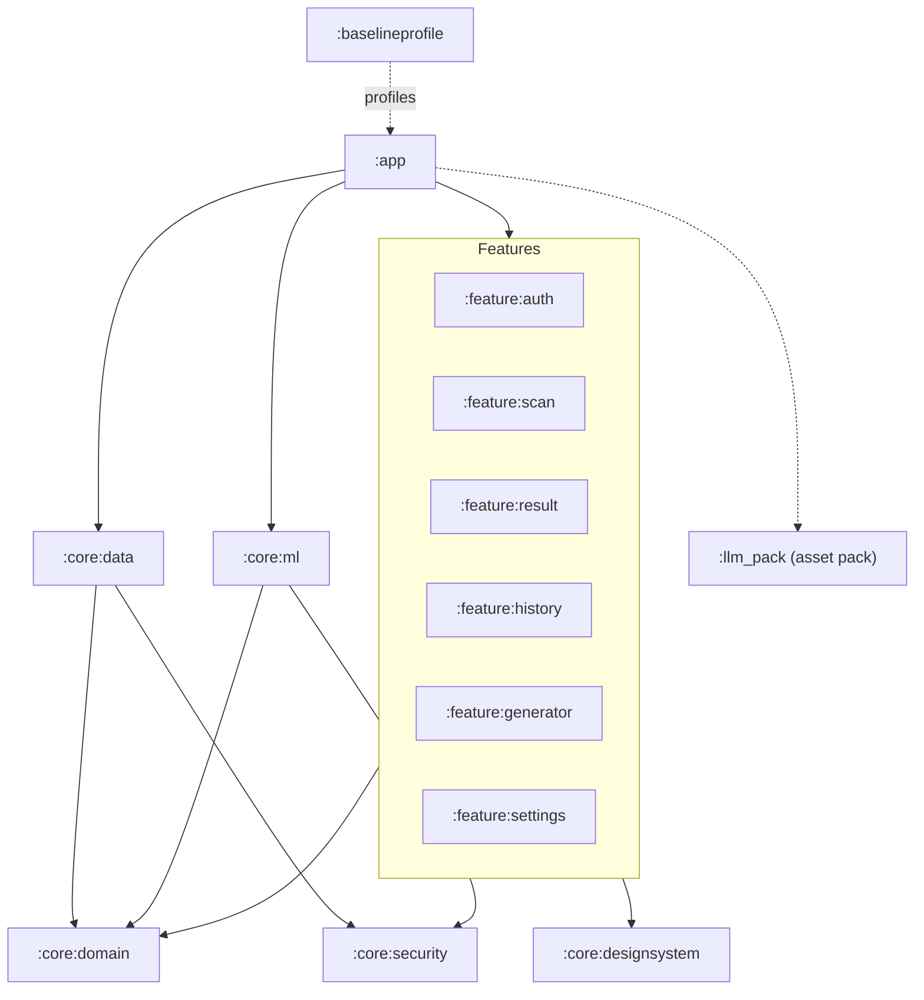
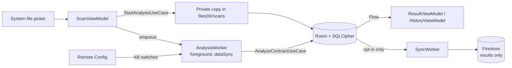
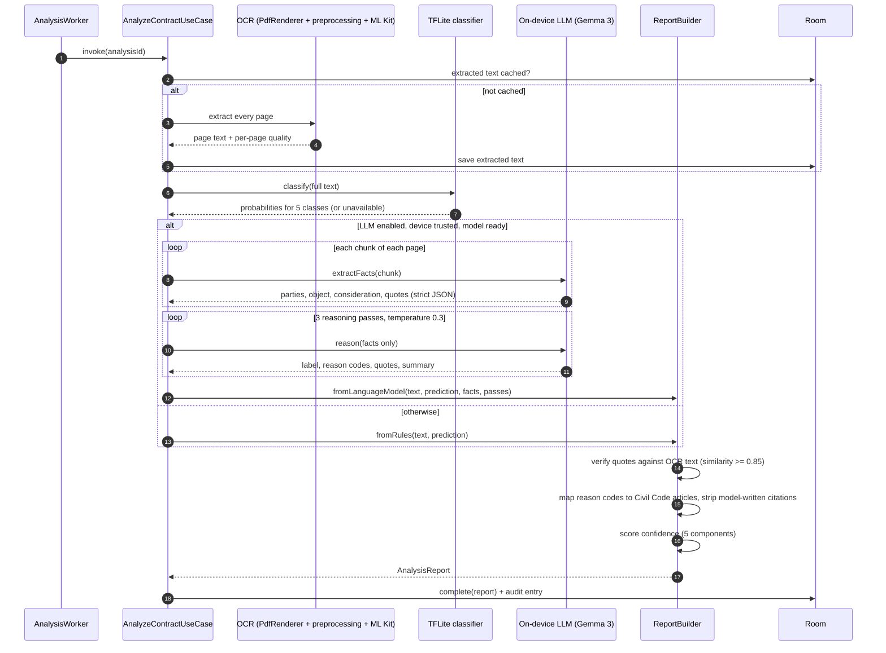
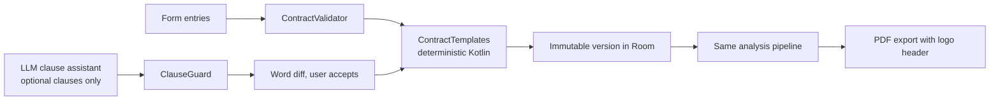

# Architecture

LegalEase is an offline-first Android app. Documents are read, analysed and stored on the phone.
The cloud handles sign-in and remote configuration, and, only when the user opts in, a backup of
analysis *results*.

## Layers

The code follows clean architecture in a multi-module Gradle build. Dependencies point inward:
features depend on the domain, data implements the domain's interfaces, and the domain depends on
nothing Android.

| Layer | Modules | Contains |
|---|---|---|
| Presentation | `:app`, `:feature:*`, `:core:designsystem` | Compose screens, ViewModels (`StateFlow` UI state), navigation, theme and shared components |
| Domain | `:core:domain` (pure Kotlin/JVM) | Models, use cases, repository and engine interfaces, the legal logic (scoring, grounding, citations, report building), the contract templates |
| Data | `:core:data`, `:core:ml`, `:core:security` | Room + SQLCipher, Firestore sync, WorkManager workers, Firebase services, OCR, the TFLite classifier, the on-device LLM, encryption |

Hilt wires the implementations to the domain interfaces. The domain module also publishes test
fixtures (`testFixtures`): fakes for every repository and engine, used by unit tests and by the
Compose UI tests.

## Module map



| Module | Responsibility |
|---|---|
| `:app` | `MainActivity`, the dashboard, the navigation graph, the Hilt application, App Check, and StrictMode and LeakCanary in debug |
| `:feature:auth` | Intro screen and the login, registration and password-reset bottom sheets |
| `:feature:scan` | PDF and image selection, scan progress |
| `:feature:result` | Result screen (verdict, reasons, quotes, citations) and the page viewer |
| `:feature:history` | Paged, searchable history of analyses |
| `:feature:generator` | Contract generator: template list, form, preview, clause assistant, PDF export |
| `:feature:settings` | Privacy notice, cloud-backup consent, data export, retention, account deletion, app lock |
| `:core:designsystem` | Theme (`Color.kt`, `Type.kt`) and shared components |
| `:core:domain` | Use cases, models, legal logic, templates; no Android dependencies |
| `:core:data` | Repositories, encrypted Room database, Firestore sync, workers, Remote Config, Play Integrity, telemetry |
| `:core:ml` | PDF rasterising, OCR preprocessing and quality, ML Kit OCR, TFLite classifier, on-device LLM and model delivery, sealed prompts |
| `:core:security` | Android Keystore keys, AES-256-GCM, streaming encryption for model files |
| `:llm_pack` | Play Asset Delivery fast-follow pack for the language model (files not in git) |
| `:baselineprofile` | Baseline profile generator and cold-start benchmark |
| `build-logic` | Convention plugins shared by all modules (SDK levels, Compose, Hilt, detekt, features) |

## Data flow



1. The user picks a PDF or images. `StartAnalysisUseCase` copies them into app-private storage,
   creates a queued analysis in Room, and enqueues `AnalysisWorker` as unique work.
2. The worker runs as a foreground service, so a long scan continues while the app is in the
   background. It writes progress and the final report to Room.
3. Screens observe Room through `Flow`, so progress and results appear without polling and
   survive process death.
4. When the user has opted in to cloud backup, `SyncWorker` pushes results (never OCR text or
   files) to `users/{uid}/…` in Firestore, and pulls newer ones. The newer `updatedAt` wins.

## Analysis pipeline



Notes:
- **Every page is processed.** A page fails only if all its chunks fail, and failed pages are
  listed in the report, never dropped silently.
- **The model never supplies law.** It returns reason codes; `CivilCodeCitations` maps them to
  reviewed article references, and `ReportBuilder` removes any article number the model writes.
- **Quotes must be real.** A quote that cannot be found in the OCR text (similarity below 0.85)
  is removed, and the grounding score drops.
- **Fallback.** With the model unavailable, switched off (`enable_llm`), or the device marked
  compromised by Play Integrity, `RuleBasedExplainer` produces a basic report that is always
  "Inconclusive — needs review".

## Confidence scoring

`ConfidenceScorer` (in `:core:domain`, version 2) computes a weighted sum of five components,
each in [0, 1]:

```
confidence = 0.30 × selfConsistency
           + 0.25 × grounding
           + 0.15 × agreement
           + 0.15 × ocrQuality
           + 0.15 × completeness
```

| Component | Definition |
|---|---|
| selfConsistency | Passes that agree with the majority label ÷ passes attempted (3). Failed passes count against it. |
| grounding | Reasons whose quote was verified in the OCR text ÷ all reasons. |
| agreement | The classifier's probability for the LLM's majority label. 0 if the classifier did not run. |
| ocrQuality | Mean OCR quality across pages. Per page: 70% ML Kit line confidence (weighted by line length) + 30% share of readable characters. |
| completeness | ½ × (pages analysed ÷ pages) + ½ × (essential elements located ÷ 3). The elements are consent, object and cause (Civil Code Art. 1318). |

| Total | Band | Shown to the user |
|---|---|---|
| ≥ 0.90 | High confidence | The classification |
| ≥ 0.80 | Confident | The classification |
| < 0.80 | Inconclusive | "Inconclusive — needs review", with the reasons it is unclear |

Consequences of the design:
- Without the language model, selfConsistency and agreement are both 0, so the score is at most
  0.55. The classifier alone can never produce a shown verdict.
- Poor scans or missing elements can keep a result below 0.80 even when every model pass agrees.
- Each component is stored with the result and in the audit log, so any verdict can be explained
  after the fact.

The 0.80 threshold is fixed in code (`ConfidenceScore.SHOW_THRESHOLD`). If calibration shows
that verdicts at 0.80 or above are right less than 80% of the time, the weights are tightened
and `ConfidenceScorer.VERSION` is raised. The threshold is never lowered (TESTING.md).

## Contract generator



- The four templates (Contract of Lease, Contract of Loan, Deed of Absolute Sale, Lease of
  Personal Property) are plain Kotlin. Their mandatory clauses come only from the form.
- The model may only suggest or reword optional clauses. `ClauseGuard` withholds any suggestion
  that cites law, states an amount or a date, or changes a number or a party.
- Every saved version is analysed with the same pipeline as an uploaded contract before export.

## Model delivery

| Model | Delivery | Integrity |
|---|---|---|
| TFLite classifier (`model_small_int8`) | Firebase ML model downloader. It moves to Cloud Storage before Firebase ML shuts down on 2027-06-15. | Input and output shapes checked at load |
| Gemma 3 1B / 270M (LiteRT-LM, int4) | Play Asset Delivery `llm_pack` (fast-follow), or a one-time Wi-Fi download from Cloud Storage `models/` | SHA-256 and size pinned in `ModelCatalog`; stored encrypted (SECURITY.md) |

The device's RAM decides the tier. Without a pinned hash, no model is loaded.

## Background work

| Work | When | Constraints |
|---|---|---|
| `AnalysisWorker` | Per scan, unique per analysis | Foreground (`dataSync`) |
| `SyncWorker` | After changes, and periodically | Network, signed in, opted in |
| `ModelDownloadWorker` → `OfflineModelWorker` → `LlmWarmUpWorker` | Chained once per launch, kept until done | Classifier: any network. LLM: unmetered, battery and storage not low. Warm-up: charging and idle |
| `RetentionWorker` (`retention-daily`) | Daily, and when the setting changes | None |

## Key decisions

- **On-device analysis.** Contracts contain personal data, so analysis must work without sending
  documents anywhere (RA 10173). The earlier cloud Gemini integration was removed.
- **A two-stage LLM.** Small models reason badly over long OCR text, so they first extract
  structured facts per chunk, then reason only over those facts.
- **Scoring that cannot be gamed.** The display threshold cannot be reached without independent
  evidence: agreement between passes, quotes verified in the text, and a readable scan.
- **Offline-first storage.** Room is the source of truth. Firestore is an optional, results-only
  backup.
