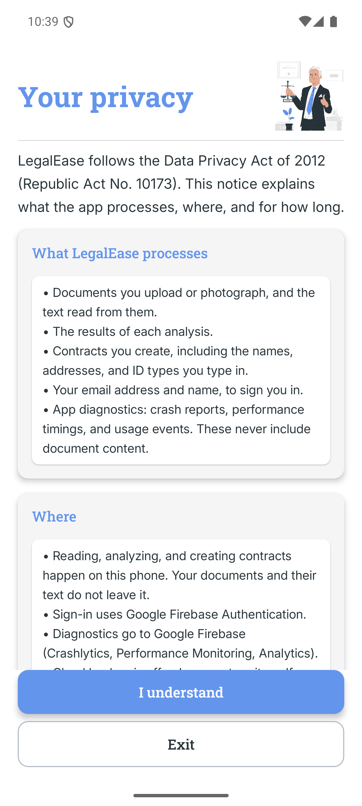
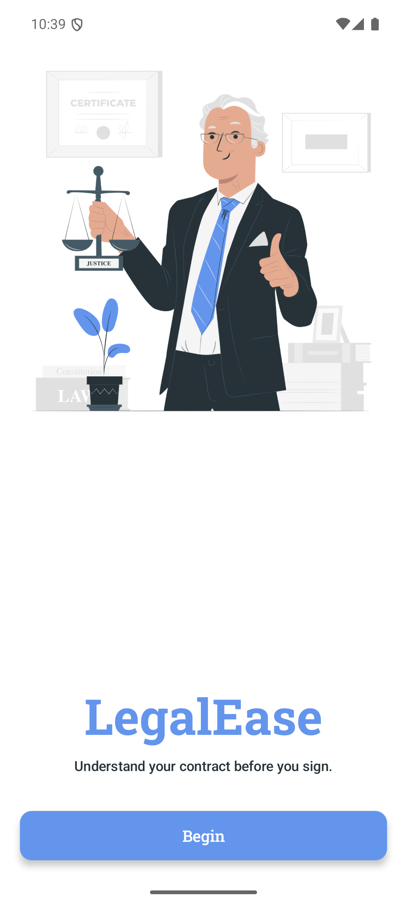
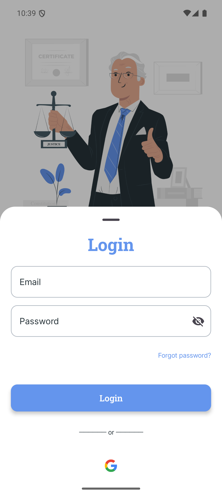
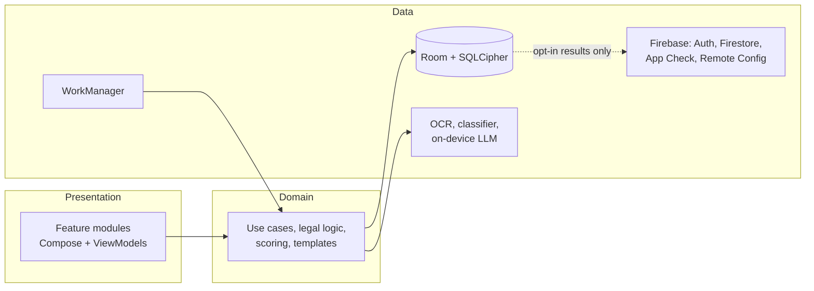

<p align="center">
  
</p>

<h1 align="center">LegalEase</h1>

<p align="center">
  Read, understand and draft Philippine contracts on your phone, offline.
</p>

LegalEase scans a contract (PDF or photos) and classifies it under the **Civil Code of the
Philippines** as **Void, Voidable, Unenforceable, Rescissible or Enforceable**. It explains the
result with the clauses it relied on, quoted from the document, and the Civil Code articles that
apply. When the evidence is not strong enough, it says **"Inconclusive — needs review"** instead
of guessing. It also drafts four common contracts.

Documents are read and analysed on the device. They are never uploaded.

> **Disclaimer.** LegalEase provides general information, not legal advice. Consult a lawyer for
> binding decisions.

## Features

- **Scan and analyse.** Multi-page PDFs or photos are read with on-device OCR. Pages are
  preprocessed and scored for quality, and poor scans are flagged for rescanning.
- **Explained verdicts.**
  - Each reason quotes the clause it is based on and links to that page.
  - Civil Code citations come from a reviewed table, never from the model.
  - A verdict is shown only at 80% confidence or higher.
- **Fully offline analysis.** A TFLite classifier and an on-device Gemma 3 language model
  (LiteRT-LM) run on the phone. If the model is unavailable, a rule-based check still runs, and
  its result is always marked "needs review".
- **Contract generator.** Contract of Lease, Contract of Loan, Deed of Absolute Sale, and Lease of
  Personal Property.
  - Guided forms with validation.
  - Optional clause suggestions, with every change shown as a diff first.
  - Each version is analysed by the same pipeline, then exported to PDF in A4 or Legal.
- **History.** Searchable and paged, with every past result and its supporting pages.
- **Privacy controls (RA 10173).**
  - Privacy notice and an opt-in cloud backup of results only.
  - Data export, retention settings, and account deletion (in the app or on the web).
  - App lock, and screenshot blocking on sensitive screens.
- **English and Filipino.**

## Screenshots

| Privacy notice | Intro | Login |
|---|---|---|
|  |  |  |

| Dashboard | Result | Generator |
|---|---|---|
| _Screenshot to be added_ | _Screenshot to be added_ | _Screenshot to be added_ |

<!-- Images live in docs/screenshots/. Screens past sign-in need a verified account. The result
     screen and contract editor block screenshots (FLAG_SECURE), so capture them from a build with
     SecureContent disabled, or photograph a test device. Use made-up contracts only. -->

## Architecture



The app uses clean architecture across multi-module Gradle, with Hilt, unidirectional data flow
and offline-first storage. [ARCHITECTURE.md](ARCHITECTURE.md) covers the layers, the analysis
pipeline (with a sequence diagram) and the confidence formula.

### Module map

| Module | Purpose |
|---|---|
| `:app` | Entry point, dashboard, navigation, app-wide setup |
| `:feature:auth` | Intro, sign-in, registration, password reset |
| `:feature:scan` | PDF and image selection, scan progress |
| `:feature:result` | Verdict, reasons, citations, page viewer |
| `:feature:history` | Past analyses, search |
| `:feature:generator` | Contract templates, form, clause assistant, PDF export |
| `:feature:settings` | Privacy, data controls, app lock |
| `:core:designsystem` | Theme and shared components |
| `:core:domain` | Pure-Kotlin use cases, models, legal logic |
| `:core:data` | Repositories, encrypted database, sync, background work |
| `:core:ml` | OCR, TFLite classifier, on-device LLM |
| `:core:security` | Keystore keys and encryption |
| `:llm_pack` | Play Asset Delivery pack for the language model |
| `:baselineprofile` | Startup baseline profile and benchmark |

## Tech stack

| Area | Technology |
|---|---|
| Language and UI | Kotlin 2.4, Jetpack Compose (Material 3), Navigation Compose |
| Architecture | Multi-module clean architecture, Hilt, coroutines and Flow, WorkManager |
| Storage | Room with SQLCipher, DataStore, Android Keystore |
| On-device ML | ML Kit Text Recognition, LiteRT (TFLite) classifier, LiteRT-LM with Gemma 3 (1B or 270M, int4) |
| Firebase | Authentication (email and Google), Firestore, Cloud Storage, App Check (Play Integrity), Remote Config, Crashlytics, Performance, Analytics, Cloud Functions, Hosting |
| Quality | JUnit, Turbine, Compose UI tests, Kover (70% gate), detekt with ktlint, Android Lint, LeakCanary, StrictMode, Baseline Profiles |
| CI/CD | GitHub Actions, Dependabot, dependency review, Gradle Play Publisher |

minSdk 31, targetSdk 35, compileSdk 37.

## Getting started

```sh
git clone https://github.com/Daddyk5/LegalEase.git
cd LegalEase
# Add app/google-services.json from your Firebase project (SETUP.md §2)
./gradlew :app:installDebug
```

[SETUP.md](SETUP.md) takes you from a fresh clone to a Firebase-connected debug build in about 30
minutes: Firebase project, authentication, security rules, App Check, models, and release
signing.

| Document | Covers |
|---|---|
| [SETUP.md](SETUP.md) | Firebase, models, release builds, CI secrets |
| [ARCHITECTURE.md](ARCHITECTURE.md) | Layers, data flow, analysis pipeline, confidence scoring |
| [TESTING.md](TESTING.md) | Automated and manual tests, accessibility, calibration |
| [SECURITY.md](SECURITY.md) | Threat model, model protection, secrets, reporting vulnerabilities |
| [PRIVACY.md](PRIVACY.md) | Privacy policy under RA 10173 |
| [CONTRIBUTING.md](CONTRIBUTING.md) | Workflow, conventions, release steps, repository settings |
| [CHANGELOG.md](CHANGELOG.md) | Notable changes |

## Privacy

Contracts never leave the phone: OCR, classification and the language model all run on the
device, and documents are stored encrypted. Cloud backup is off until you turn it on, and then it stores analysis results only, never document
text or files. You can export or delete everything, in the app or at the web deletion page.
[PRIVACY.md](PRIVACY.md) has the full policy.

## Research & Validation

LegalEase began as a capstone research project.

| | |
|---|---|
| Institution | _[to be filled in]_ |
| Researchers | Kenneth T. Gulmatico, Katrina Cassandra Ibanez, James Michael Micolob, Reynaldo Q. Pagaran Jr. |
| Adviser and legal reviewer | _[to be filled in]_ |
| Year | _[to be filled in]_ |

**Dataset.** _[To be filled in: the source, size and label distribution of the contracts used to
train the classifier.]_ Calibration uses a separate set of 30–50 real Philippine contracts
labelled by a licensed lawyer, as described in [TESTING.md](TESTING.md).

**Model approach.** The analysis combines three components:
- A quantised TFLite text classifier gives a preliminary label over the five classes.
- An on-device Gemma 3 model extracts facts from each page, then reasons over those facts three
  times, for self-consistency.
- Rules check for the essential elements of a contract: consent, object and cause (Civil Code
  Art. 1318).

A result is shown only when a weighted confidence score reaches 0.80. The score combines:
- agreement between the reasoning passes
- quotes verified in the document
- agreement with the classifier
- OCR quality
- completeness

The classifier alone cannot reach that threshold.

**Measured accuracy at the 0.80 threshold.** _Not yet measured._ This will be filled in from the
calibration results in [TESTING.md](TESTING.md), with the share of contracts that receive a verdict
(coverage) and the accuracy of the verdicts shown.

## License

[MIT](LICENSE). The Gemma model is not part of this repository and is distributed under the
[Gemma Terms of Use](https://ai.google.dev/gemma/terms).
